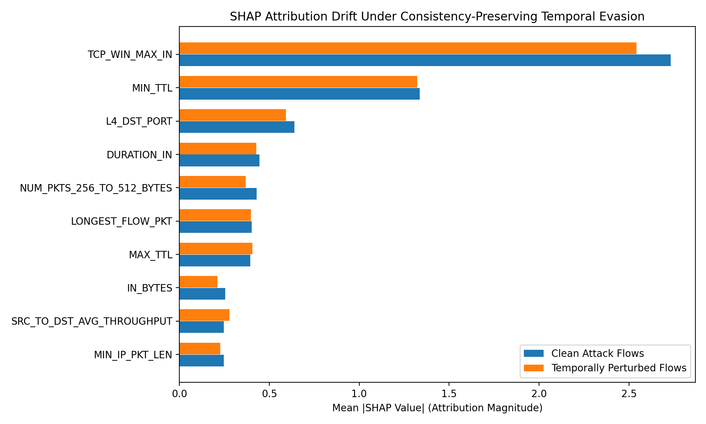

# Adversarial Robustness Audit of Network Intrusion Detection Systems (NIDS)

An empirical robustness and explainability audit evaluating tree-based Network Intrusion Detection Systems (`LightGBM`) under **consistency-preserving temporal evasion attacks** on the **NF-CSE-CIC-IDS2018-v2** NetFlow dataset.

---

## 1. Core Methodology & Pipeline Architecture

Unlike naive feature-space perturbations that break network physics, this pipeline enforces **algebraic flow consistency**:
- **Leak-Free Data Ingestion (`src/01_ingest_and_split.py`):** Streams the 43-feature `NF-CSE-CIC-IDS2018-v2` Parquet dataset in memory-safe batches, strips port/identifier leakage, deduplicates post-anonymization flows, and performs a strict 70/30 stratified split (`70,000` train / `30,000` test across `Benign`, `DDoS`, `DoS`, and `BruteForce`).
- **Consistency-Preserving Perturbation Engine (`src/02_perturbation_engine.py`):** Simulates slow-rate temporal evasion ($\alpha \sim U(1.5, 3.0)$) by dilating duration features (`FLOW_DURATION_MILLISECONDS`, `DURATION_IN`, `DURATION_OUT`) by $\alpha$ while inversely scaling rate/throughput features (`SRC_TO_DST_SECOND_BYTES`, `SRC_TO_DST_AVG_THROUGHPUT`, etc.) by $1/\alpha$, keeping byte totals, packet counts, and packet-size histograms strictly invariant.
- **Comparative Model Evaluation (`src/03_train_models.py`):** Benchmarks five LightGBM configurations (`M1` Standard, `M2` Cost-Sensitive, `M3` Timing-Ablated, `M4` Adversarially Trained, and `M5` SHAP-Guided Invariant Ratio) on clean vs. out-of-distribution (OOD) perturbed traffic (`results/robustness_comparison.csv`).
- **SHAP Attribution Drift Audit (`src/04_shap_audit.py`):** Quantifies feature reliance shifts between clean and temporally perturbed attack flows using `TreeExplainer` (`results/shap_feature_drift.csv`).

---

## 2. Diagnostic Results

All reproducible evaluation metrics and attribution tables are exported to [`results/`](results/):
- **Robustness Metrics:** [`results/robustness_comparison.csv`](results/robustness_comparison.csv)
- **SHAP Attribution Drift Table:** [`results/shap_feature_drift.csv`](results/shap_feature_drift.csv)

---

## 3. Reproducibility

    pip install -r requirements.txt
    python src/01_ingest_and_split.py
    python src/02_perturbation_engine.py
    python src/03_train_models.py
    python src/04_shap_audit.py

---

## 4. Contributors & Engineering Ownership

| Contributor | GitHub | Core Responsibilities |
| :--- | :--- | :--- |
| **Aditi Maharor** | [@aditi-io](https://github.com/aditi-io) | **Core ML & Adversarial Pipeline Engineering:** Batch-safe Parquet ingestion, deduplication, and leak-free splitting (`01_ingest_and_split.py`), algebraic consistency-preserving perturbation engine (`02_perturbation_engine.py`), M1–M5 LightGBM robustness benchmarking (`03_train_models.py`), and SHAP drift diagnostic automation (`04_shap_audit.py`). |
| **Shreyanka Basak** | [@shreyankabasak](https://github.com/shreyankabasak) | **System Architecture, Empirical Analysis & Reporting:** Repository architecture and dependency management (`requirements.txt`), comparative OOD evaluation analysis, SHAP feature-drift interpretation, technical documentation, and final project report synthesis. |